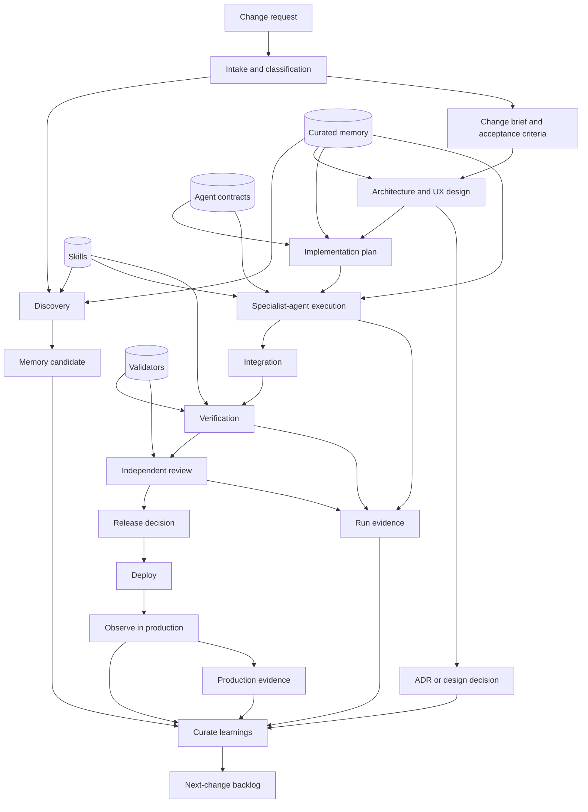
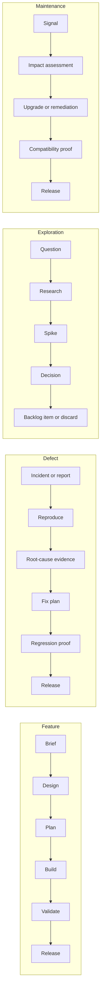
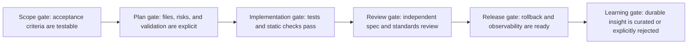

# Agent SDLC Lifecycle DAG

## Purpose

An editable, acyclic operating model for Pi-based software delivery. It separates durable knowledge, reusable capability, task execution, and independent evidence so that a change can be traced from request through production learning.

## Collaboration medium

The Git repository is the shared system of record. Markdown artifacts are the durable conversation: a change brief, plan, decisions, evidence, and handoff all live with the code and are versioned together. Pi sessions are the execution surface, not the source of truth.

Suggested layout:

```text
.ai/
  memory/           # Durable, curated facts and decisions
  skills/           # Reusable procedures and tool guidance
  agents/           # Role contracts, prompts, permissions, handoffs
  validators/       # Executable quality gates and evaluation rubrics
  runs/             # Per-change ephemeral run manifests and evidence
  engineering/      # Architecture, lifecycle, and ADRs
```

## Master DAG



The arrows only move forward. A failed gate creates a new, linked change request in `next-change backlog`; it never mutates history or creates a hidden feedback loop.

## Flow variants



## Core contracts

| Layer | Owns | Must produce |
| --- | --- | --- |
| Memory | Stable, reusable facts; never raw chat logs | Source, confidence, scope, expiry/review date |
| Skills | Repeatable methods | Inputs, steps, tool access, outputs, failure modes |
| Agents | A bounded role and authority | Goal, allowed writes, handoff schema, stop conditions |
| Validators | Independent claims about quality | Command/rubric, expected evidence, severity, owner |
| Run manifest | One execution of one change | Inputs, agents/skills used, artifacts, gate outcomes |

## Non-negotiable gates



## Initial operating rules

1. Treat memory as reviewed data, not autonomous agent recollection.
2. Keep agent roles narrow: a planner does not approve its own plan; an implementer does not waive its own failures.
3. Make validators executable where possible; reserve model judgment for explicit rubrics and record its evidence.
4. Give every run an immutable manifest and every release a trace back to its brief and validation evidence.
5. Start with one orchestrator plus planner, implementer, tester, and reviewer roles; split roles only when the handoff cost is justified.

## Decisions to tailor next

- Which tasks may run autonomously, and which need your explicit checkpoint?
- Where does canonical memory live: Markdown, SQLite, a vector index, or a hybrid?
- What risk levels determine validator depth and required human review?
- Which Pi extensions/tools are permitted per role?
- What constitutes release for this app: merge, preview build, store submission, or production telemetry?
